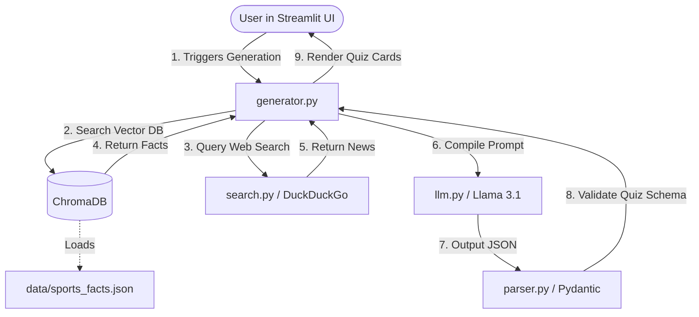

# SportIQ - RAG Sports Quiz Generator

SportIQ is an AI-powered sports trivia application that leverages the **Retrieval-Augmented Generation (RAG)** pattern to create grounded, hallucination-free quizzes. The engine pulls from a local historical facts database and cross-references live search snippets before prompting a Large Language Model (Llama 3.1) to generate questions, preventing typical AI trivia inaccuracies.

---

## 🏗️ Architecture & Component Design

SportIQ employs a clean, modular architecture separating data indexing, external search, LLM completion, validation parsing, and the interactive frontend.




## 📂 Project Directory Structure

```
sports-quiz/
│
├── app.py                 # Streamlit frontend dashboard & interactive UI
├── requirements.txt       # Project python dependencies
├── README.md              # Documentation & Architecture diagrams
├── .env.example           # Example template for environment configurations
├── .gitignore             # File exclusion settings
│
├── data/
│   └── sports_facts.json  # Historical database of sports facts
│
├── chroma_db/             # Local directory containing persistent ChromaDB vectors
│
├── logs/
│   └── app.log            # Running application logs (rotates at 10MB)
│
├── src/
│   ├── config.py          # Environment loader and path manager
│   ├── database.py        # ChromaDB setup, embedding generation & semantic search
│   ├── search.py          # DuckDuckGo search integration
│   ├── llm.py             # Provider-agnostic LLM interface (Groq, Together, Ollama, OpenAI)
│   ├── prompts.py         # System, formatting, and grounding prompt templates
│   ├── parser.py          # Pydantic schemas and raw JSON validators
│   ├── generator.py       # RAG pipeline coordinator
│   └── utils.py           # Loguru config, character cleaner, & PDF generator
│
└── assets/                # App UI assets
```

---

## ⚡ Quick Start & Installation

### Prerequisites
- Python 3.10 or 3.11 installed.
- Access to an API key for **Groq** (Recommended default), **Together AI**, or **OpenAI**. 

### 1. Clone the repository and navigate to the directory
```bash
cd sport-quiz
```

### 2. Create and activate a Virtual Environment
**Windows (PowerShell):**
```powershell
python -m venv venv
.\venv\Scripts\Activate.ps1
```

**macOS/Linux:**
```bash
python3 -m venv venv
source venv/bin/activate
```

### 3. Install Dependencies
```bash
pip install -r requirements.txt
```

### 4. Setup Environment Configurations
set an environment for your local device for adding API key


 the application will print a warning log and automatically fallback to loading the local embedding model `sentence-transformers/all-MiniLM-L6-v2` into memory, enabling vector database storage without external billing.
