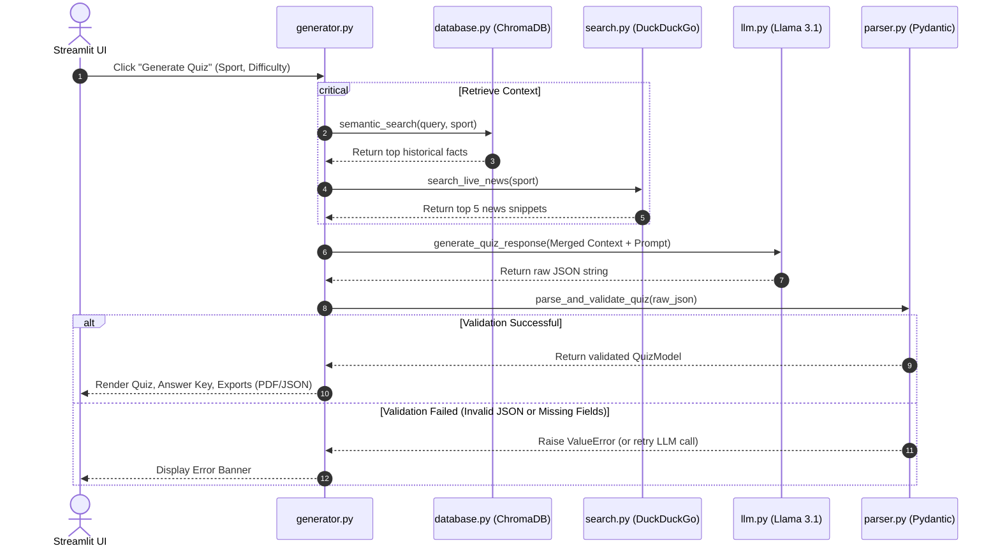

# SportIQ - RAG Sports Quiz Generator

SportIQ is an AI-powered sports trivia application that leverages the **Retrieval-Augmented Generation (RAG)** pattern to create grounded, hallucination-free quizzes. The engine pulls from a local historical facts database and cross-references live search snippets before prompting a Large Language Model (Llama 3.1) to generate questions, preventing typical AI trivia inaccuracies.

---

## 🏗️ Architecture & Component Design

SportIQ employs a clean, modular architecture separating data indexing, external search, LLM completion, validation parsing, and the interactive frontend.


### Flow Diagram: Generation Pipeline



---

## 📂 Project Directory Structure

```
sports-quiz/
│
├── app.py                 # Streamlit frontend dashboard & interactive UI
├── requirements.txt       # Project python dependencies
├── README.md              # Documentation & Architecture diagrams
├── .env.example           # Example template for environment configurations
├── .gitignore             # File exclusion settings
│
├── data/
│   └── sports_facts.json  # Historical database of sports facts
│
├── chroma_db/             # Local directory containing persistent ChromaDB vectors
│
├── logs/
│   └── app.log            # Running application logs (rotates at 10MB)
│
├── src/
│   ├── config.py          # Environment loader and path manager
│   ├── database.py        # ChromaDB setup, embedding generation & semantic search
│   ├── search.py          # DuckDuckGo search integration
│   ├── llm.py             # Provider-agnostic LLM interface (Groq, Together, Ollama, OpenAI)
│   ├── prompts.py         # System, formatting, and grounding prompt templates
│   ├── parser.py          # Pydantic schemas and raw JSON validators
│   ├── generator.py       # RAG pipeline coordinator
│   └── utils.py           # Loguru config, character cleaner, & PDF generator
│
└── assets/                # App UI assets
```

---

## ⚡ Quick Start & Installation

### Prerequisites
- Python 3.10 or 3.11 installed.
- Access to an API key for **Groq** (Recommended default), **Together AI**, or **OpenAI**. 

### 1. Clone the repository and navigate to the directory
```bash
cd sport-quiz
```

### 2. Create and activate a Virtual Environment
**Windows (PowerShell):**
```powershell
python -m venv venv
.\venv\Scripts\Activate.ps1
```

**macOS/Linux:**
```bash
python3 -m venv venv
source venv/bin/activate
```

### 3. Install Dependencies
```bash
pip install -r requirements.txt
```

### 4. Setup Environment Configurations
Copy `.env.example` to a new file named `.env`:
```bash
copy .env.example .env
```
Open `.env` and fill in your details:
- Enter your `GROQ_API_KEY` (if using Groq).
- Enter your `OPENAI_API_KEY` (required for OpenAI embeddings).
- Customize `LLM_PROVIDER` (e.g. `groq`, `together`, `ollama`, or `openai`).

---

## 🎮 Running the Application

Launch the Streamlit web dashboard:
```bash
streamlit run app.py
```

Open `http://localhost:8501` in your browser.
1. Use the **Sidebar** to choose a Sport and Difficulty level.
2. Expand **LLM & API Credentials** in the sidebar to configure keys or adjust providers dynamically in the UI.
3. Click **Generate RAG Quiz**.
4. Test your knowledge! Select answers, check answers individually, or click **Submit Whole Quiz** to calculate your scoreboard.
5. Export your results by downloading the quiz sheet as a **PDF** or raw **JSON**.

---

## 📝 API Usage (Modular Import)

You can run the RAG generation pipeline programmatically in other Python scripts:

```python
from src import database, generator

# 1. Initialize DB Connection
db_client = database.initialize_database()

# 2. Run Quiz generator (Returns dict)
result = generator.generate_quiz_rag(
    sport="Cricket",
    difficulty="Medium",
    db_client=db_client,
    provider="groq",
    api_key="your-api-key"
)

if result["status"] == "success":
    print("Generated Quiz:", result["quiz"])
    print("Retrieved facts count:", len(result["historical_context"]))
```

---

## 🛠️ Troubleshooting

### 1. DuckDuckGo Rate Limits or Empty Search Results
If DuckDuckGo live search blocks requests (returning empty arrays), the system is built to degrade gracefully. It logs the search failure and continues generating the quiz using **only** ChromaDB historical facts, preventing application crashes.

### 2. API Key Errors
If you see credential errors, verify that:
- Your `.env` variables match the selected `LLM_PROVIDER`.
- You entered the API keys correctly in the sidebar parameters.

### 3. ChromaDB Issues on Windows
If you run into issues installing ChromaDB on Windows (e.g. compiler error), make sure you have the C++ build tools installed. If compilation fails, installing binary wheels by running `pip install chromadb` usually succeeds automatically on modern Python environments.

### 4. Embedding Fallback
If you do not have an `OPENAI_API_KEY` configured, the application will print a warning log and automatically fallback to loading the local embedding model `sentence-transformers/all-MiniLM-L6-v2` into memory, enabling vector database storage without external billing.
